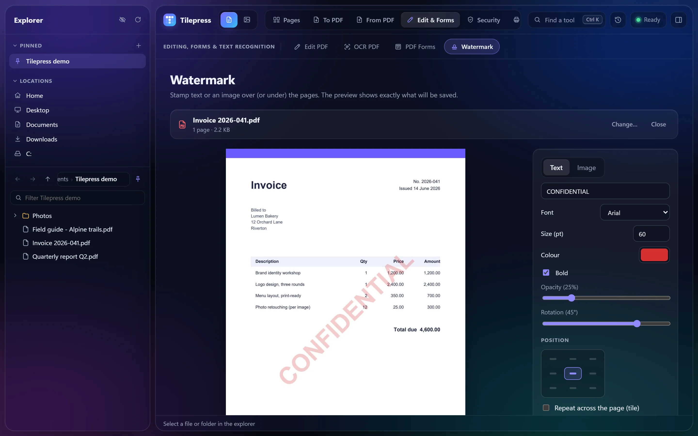

# Edit, forms & OCR

These tools change what is on a PDF's pages: retype text, add pictures and shapes, black out confidential text, add a searchable text layer to scans, fill in or create form fields, and stamp a watermark. In the app this category is the **Edit & Forms** tab under **Documents**.

All four tools work on one open PDF, the same one the page tools use, so a file you opened in Split PDF or Rotate PDF is already open here. To open a PDF, drag it from the Explorer onto the tool, click **Open PDF…**, or click **Use** followed by the name of the PDF selected in the Explorer. Right-clicking a PDF in the Explorer and choosing **Edit PDF** opens it straight in Edit PDF. See [The Tessera window](/docs/interface) for the Explorer and the other general controls.

Every tool saves a **new** file and leaves the original alone. When it's done, a **Saved** card lists the result with **Open**, **Show in folder** and **Keep editing this file**, which opens the result in the same tool for the next step. Each run is also listed in the [History](/docs/history).

::: details How to type page ranges
OCR PDF and Watermark PDF take a list of pages:

- Single pages and ranges, separated by commas or semicolons: `1-3, 5, 8-10`.
- Open-ended ranges: `8-` means page 8 to the end, `-4` means pages 1 to 4.
- The words `all`, `odd` and `even`.

Leave the box empty to use every page.
:::

## Edit PDF

Edit PDF lets you retype existing lines of text, add text, pictures, boxes, ellipses and highlights, cover things with white, and redact. Your changes are drawn into the pages when you save.

### How to use it

1. Open **Edit PDF** and open a PDF.
2. Pick a tool in the toolbar above the page: **Select**, **Edit text**, **Text**, **Image**, **Box**, **Ellipse**, **Highlight**, **White-out** or **Redact**. A short hint for the chosen tool appears at the right of the toolbar.
3. Click or drag on the page:
   - **Text**: click to add a text box, or drag to give it a size. It starts with the word "Text"; type over it in the side panel.
   - **Box**, **Ellipse**, **Highlight**, **White-out**, **Redact**: drag over the area. A plain click adds one at a standard size.
   - **Image**: clicking the tool opens a file dialog. The picture is placed in the middle of the page.
   - **Edit text**: every line of existing text gets a clickable area. Click a line to replace it (see [Editing existing text](#editing-existing-text) below).
4. After you add an object, the tool switches back to **Select**. Drag an object to move it, or drag its handles to resize it. Its settings appear in the side panel.
5. Use the page arrows or type a page number under the page to move between pages. You can change several pages before saving.
6. Click **Save edited PDF…**, choose a name and folder, and click **Save**.

To remove an object, select it and press <kbd>Delete</kbd> (or <kbd>Backspace</kbd>), or click **Delete (Del)** in the side panel. **Discard all** removes every change you haven't saved. The **Changes** list shows how many objects you've added on each page.

### Editing existing text

When you click a line with **Edit text**, Tessera puts two objects on the page:

- a white-out box over the old line, set to also remove the old text from the file, and
- a new text box with the same words, at the same size, in bold if the line was bold, and in the closest of the three fonts (Arial, Times New Roman or Courier New).

The text field in the side panel gets the focus, so you can start typing. The whole line is replaced, not single words.

### Options

The side panel shows the settings of the selected object.

| Object | Settings | Defaults |
|---|---|---|
| Text | The text itself (press <kbd>Enter</kbd> for a new line), **Font** (Arial, Times New Roman, Courier New), **Size (pt)** from 4 to 200, **Colour**, **Bold**, **Italic**, **Opacity** | Arial, 14 pt, black, 100% |
| Image | **Opacity** | 100% |
| Box, Ellipse | **Outline** with its colour, **Fill** with its colour, **Line width** (0.5 to 20 pt), **Opacity** | Red outline, no fill (light yellow when you tick **Fill**), 1.5 pt, 100% |
| Highlight | **Opacity** (never more than 40%, so the text stays readable) | Yellow |
| White-out | **Also remove the text underneath** | Off |
| Redact | None. The text under the box is always deleted from the file. | Black |

Under the settings you see the object's position and size in points.

### Good to know

- The file is suggested as `name_edited.pdf` next to the original. If that name is taken, it suggests `name_edited (2).pdf`.
- Pictures can be JPG, PNG, GIF, BMP, TIFF or WebP. Transparent areas in PNGs stay transparent. Resizing a picture doesn't keep its proportions, so drag a corner carefully.
- Text doesn't wrap inside its box. Start a new line with <kbd>Enter</kbd>.
- Text is written with Arial, Times New Roman or Courier New taken from Windows and embedded in the PDF, so accented and non-Latin letters work. If a font file is missing, a standard PDF font is used instead, which only covers Latin letters.
- **Edit text** works on ordinary text PDFs. A scan has no text to find, so run [OCR PDF](#ocr-pdf) on it first. The replacement text is always black at first; change **Colour** if the original was coloured.
- Tessera finds a "line" by grouping words at the same height. On a page with two columns, one line can run across both.
- White-out only hides what is underneath unless you tick **Also remove the text underneath**. Hidden text can still be selected, copied and searched.

::: warning What Redact removes
**Redact** draws a black box and deletes the text underneath, so it can't be copied or searched. A PDF stores text in pieces (a letter, a word or a whole line, depending on the program that made it). Tessera deletes every piece that **starts** inside the box, so:

- make the box cover the start of everything you want gone, and
- a piece that starts inside the box is deleted whole, even the part that sticks out.

Pictures and drawings under the box are covered in black but stay in the file, and so does text inside embedded page objects (form XObjects). Check the saved file before you share it.
:::

## OCR PDF

OCR PDF recognises the text in scanned pages and adds it as an invisible layer, so you can search the PDF and select and copy its text. The pages look exactly the same as before.

### How to use it

1. Open **OCR PDF** and open a scanned PDF.
2. Check **Engine** and **Document language**. Tessera picks them for you (see below).
3. If you only want some pages, type them in **Pages**.
4. Click **Make searchable…**, choose a name and folder, and click **Save**.

A progress bar shows which page is being recognised. When it's done, a line under the options tells you how many pages were recognised, how many were skipped and how many words were found.

### Options

| Option | What it does | Default |
|---|---|---|
| **Engine** | **Tesseract** (only if it's installed) or **Windows OCR (built in)**. | Tesseract when it's installed, otherwise Windows OCR |
| **Document language** | The language of the text. The list shows the languages the chosen engine has. | English if Tesseract has it, otherwise the first one in the list |
| **Scan resolution** | How sharply each page is rendered before recognition: **200 dpi (faster)**, **300 dpi (recommended)** or **400 dpi (small print)**. | 300 dpi |
| **Pages** | The pages to recognise. Empty means every page. | All pages |
| **Skip pages that already have text** | Leaves pages that already contain text (at least 20 characters) as they are. | On |

### Good to know

- The file is suggested as `name_ocr.pdf` next to the original.
- Tessera needs one OCR engine:
  - **Tesseract**, if it's installed. Tessera looks for `tesseract.exe` on the `PATH` and in a `Tesseract-OCR` folder under Program Files, Program Files (x86) or your local app data folder. It offers every language Tesseract has data for.
  - **Windows OCR**, which comes with Windows 10 and 11. It offers the languages installed in **Settings → Time & language → Language** that include "Optical character recognition". These appear as language tags, such as `en-US`.
- If neither is available, the tool says so and the button stays greyed out.
- Pick the language of the document. Recognising French text with English, for example, gives poor results.
- Windows OCR can't read a page that is larger than 10,000 pixels on a side at the chosen resolution. Pick a lower resolution for very large pages.
- Only the text layer is added: the page images aren't changed, compressed or straightened.
- OCR runs on your computer. Nothing is uploaded.

## PDF Forms

PDF Forms fills in the fields of an existing form, or adds new fields to any PDF so it becomes a form.

### How to use it

1. Open **PDF Forms** and open a PDF.
2. Choose a mode at the top: **Fill form** (it shows how many fields the PDF has) or **Design fields**. A PDF with no fields opens in **Design fields**.

### Fill

1. The side panel lists every field by name. A red `*` marks a required field.
2. Fill in the fields. Clicking a field on the page selects it in the list, and clicking a field in the list shows its page.
3. To make the answers a fixed part of the page, tick **Flatten**.
4. Click **Save filled form…**, choose a name and folder, and click **Save**.

Text fields, multi-line fields, checkboxes, radio buttons, dropdowns and list boxes can be filled. Radio buttons, dropdowns and list boxes appear as a dropdown in the side panel. Signature fields and buttons aren't listed, and read-only fields are greyed out.

### Design

1. Pick a field type in the toolbar after **Add:**: **Text box**, **Multi-line text**, **Checkbox**, **Dropdown** or **List box**.
2. Click on the page to place a field at a standard size, or drag to size it.
3. Set its details in the side panel (see below).
4. To move or resize fields, click **Select** and drag them. Fields that were already in the PDF are shown in grey and can't be changed here.
5. Click **Save form…**, choose a name and folder, and click **Save**.

### Options

Fill mode:

| Option | What it does | Default |
|---|---|---|
| **Flatten** | Draws the answers into the page. The fields are removed, so the answers can no longer be changed. | Off |

Design mode, for the selected field:

| Option | What it does | Default |
|---|---|---|
| **Name** | The field's name. It must be unique in the PDF. Spaces become underscores. | `field1`, `field2`… |
| **Options (one per line)** | The choices in a dropdown or list box. | `Option 1` and `Option 2` |
| **Default value** | The value the field starts with (not for checkboxes). | Empty (a dropdown starts on its first option) |
| **Required** | Marks the field as required. | Off |
| **Remove field** | Deletes the new field. | |

### Good to know

- Filled forms are suggested as `name_filled.pdf`, designed forms as `name_form.pdf`, next to the original.
- **Save filled form…** stays greyed out until you change a field. Only the fields you changed are written.
- **Save form…** stays greyed out while a new field has no name or a name that is already used.
- New checkboxes start unticked. New fields use Helvetica, sized automatically to fit the box, with a grey border.
- You can't create radio buttons or signature fields.
- In the History, filling is listed as "Fill PDF form" and designing as "Add PDF form fields".

## Watermark PDF

Watermark PDF stamps text or a picture on the pages, over or behind the content. In the app this tool is called **Watermark**. The preview shows the real result for the page you're looking at, made by the same code that saves the file.

### How to use it

1. Open **Watermark** and open a PDF.
2. Choose **Text** or **Image** at the top of the side panel.
   - For text, type it in the box (it starts as `CONFIDENTIAL`) and pick the font, size and colour.
   - For an image, click **Choose image…** and set its size.
3. Set the opacity, rotation and position. The preview updates as you go. Use the page arrows to check other pages.
4. Click **Add watermark and save…**, choose a name and folder, and click **Save**.

### Options

| Option | What it does | Default |
|---|---|---|
| **Text** / **Image** | What to stamp. | Text |
| Text box | The watermark text. | `CONFIDENTIAL` |
| **Font** | Arial, Times New Roman or Courier New. | Arial |
| **Size (pt)** | Text size, 6 to 300 points. | 60 |
| **Colour** | Text colour. | Red |
| **Bold** | Bold text. | On |
| **Choose image…** | The picture: JPG, PNG, GIF, BMP, TIFF or WebP. | |
| **Size (% of page width)** | Width of the picture as a share of the page width, 5 to 100%. | 40% |
| **Opacity** | How solid the watermark is, 5 to 100%. | 25% |
| **Rotation** | From -90° to 90°, in steps of 5°. Positive values turn it anticlockwise. | 45° |
| **Position** | One of nine spots in a 3 × 3 grid: corners, edges or centre. | Centre |
| **Repeat across the page (tile)** | Repeats the watermark in staggered rows over the whole page instead. Untick it to go back to the centre. | Off |
| **Layer** | **Over the content** or **Behind the content**. | Over the content |
| **Pages** | The pages to stamp. Empty (shown as "All") stamps every page. | All pages |

### Good to know

- The file is suggested as `name_watermarked.pdf` next to the original.
- Positions at the edges and corners keep a margin of half an inch (about 13 mm) from the page edge.
- Tiles are spaced so they don't overlap, whatever the rotation.
- **Behind the content** puts the watermark under everything on the page. On a scanned page, the scan is one big picture that hides it. The preview shows you whether it can be seen.
- Text uses Arial, Times New Roman or Courier New from Windows, embedded in the PDF, so accented and non-Latin letters work.
- Transparent areas of a PNG stay transparent.
- To watermark images rather than PDFs, use [Watermark Image](/docs/img-edit).
