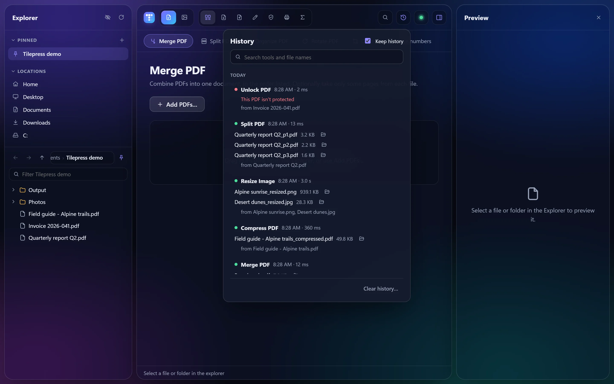

# History

Tilepress keeps a list of the files its tools make. Use it to find a file you saved last week, to see which file it was made from, or to check why a run failed. The history stays on your PC.

Click the **History** button (the clock) in the top bar to open it. Press <kbd>Esc</kbd> or click elsewhere to close it.

## What is recorded

Each time a tool saves something, or tries to and fails, one entry is added with:

- the tool's name, such as **Merge PDF** or **Compress Image**;
- when it started and how long it took;
- the files it started from (their paths);
- the files it wrote (their paths and sizes);
- for a failed run, the error message.

A few tools are listed under a more specific name:

| Tool | Listed as |
|---|---|
| PDF Forms | **Fill PDF form** or **Add PDF form fields** |
| Protect PDF | **Protect PDF**, or **Unlock PDF** when you remove a password |
| Sign PDF | **Sign PDF** for a digital signature, **Create certificate** for a new certificate. A handwritten (electronic) signature is listed as **Edit PDF**. |
| Advanced Print | **Print**, or **Print to PDF** for **Save layout as PDF** |
| PDF to JPG | **PDF to JPG** or **PDF to PNG**, by the format you chose |

For HTML to PDF and HTML to Image, the source is the web address or the HTML file you gave.

## What is never recorded

- **Tool options.** The settings you chose aren't stored. That includes every password you type into Protect PDF, Unlock or Sign PDF, so they never reach the disk.
- **What you type.** Text for Edit PDF, watermarks or page numbers, pasted HTML code and typed Markdown aren't stored.
- **The contents of your files.** Only paths, sizes, times and error messages are kept.
- **Things that don't save a file:** previews, page thumbnails, browsing in the Explorer, and compiling or saving in the LaTeX editor.

## Reading the list

The newest runs come first, grouped under **Today**, **Yesterday** or the date. Forty entries load at a time; click **Show older** at the end for more.

Each entry shows:

- a dot, red for a failed run, then the tool's name, the time and how long the run took;
- for a failed run, the error message;
- the files it made, up to three (click **and *N* more** to see the rest), with their sizes;
- "from" and the names of the files it started from. Hover over that line to see their full paths.

Click a file's name to open it in its usual app, or the folder icon next to it (**Show in folder**) to open File Explorer with the file selected. A file that has been moved or deleted since is greyed out and marked "moved or deleted".

## Searching

Type in **Search tools and file names** at the top. The list shows the runs whose tool name, or any input or output path, contains what you typed. Because the whole path is searched, a folder name finds everything made in or from that folder. Capital letters don't matter, except for accented ones.

## Removing entries

- To remove one entry, click × (**Remove from history**) on it.
- To remove everything, click **Clear history…** at the bottom of the panel, then **Clear**. The button is hidden while you're searching.

Both remove only the records. Your files stay where they are.

## Turning the history off

Untick **Keep history** at the top of the panel. Tilepress stops recording new runs, and the panel says "History is off: new runs aren't recorded." The entries you already have stay until you remove them. Tick the box again to resume.

History is on when you first install Tilepress. The choice is saved with your other settings.

## Limits and storage

- The newest 5,000 runs are kept. Older ones are removed as new ones arrive.
- The history is a database file, `%LOCALAPPDATA%\Tilepress\history.db`. While Tilepress runs, two helper files sit next to it, `history.db-wal` and `history.db-shm`.
- Two copies of Tilepress can be open at the same time and both record into the same history.
- A problem with the history never stops a tool. If the database can't be written, the tool still saves its file, and recording stops until you restart Tilepress.
- Uninstalling Tilepress keeps the history. To get rid of it, clear it first, or delete the three `history.db` files while Tilepress is closed.

See [Privacy](/docs/privacy) for everything else Tilepress keeps on your PC.
