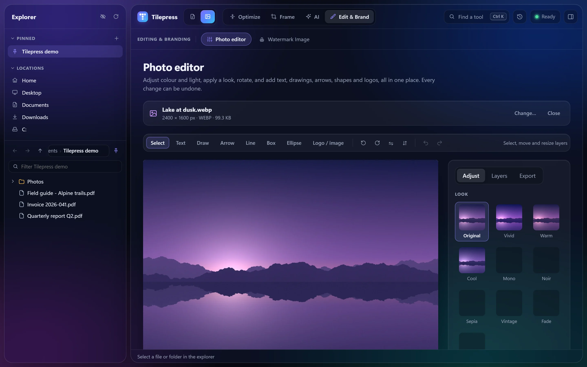

# Edit & brand

These tools are under the **Edit & Brand** tab in the **Images** section. The Photo editor works on one picture at a time: light and colour, looks, rotation, and layers of text, drawings, shapes and logos. Watermark Image stamps text or a logo on a whole batch of images.

Both tools save new files and never change the originals. The Photo editor's adjustments and the watermark preview are drawn by the same code that saves, so they show what you'll get. To open a picture in the Photo editor, right-click it in the Explorer and choose **Edit photo**, or click **Edit photo** in the Preview panel. See [The Tessera window](/docs/interface) for the Explorer and the other general controls.

## Photo editor

The Photo editor adjusts light and colour, applies a look, rotates or flips the picture, and adds text, freehand drawing, arrows, lines, boxes, ellipses and logos. Every change can be undone.

### How to use it

1. Open an image: drag it from the Explorer onto the tool, click **Open image…**, or select it in the Explorer and click the **Use** button with its name.
2. Use the three panels on the right: **Adjust** for looks and sliders, **Layers** for text, drawings, shapes and logos, and **Export** for the file format.
3. Use the toolbar above the picture to add layers, rotate or flip, and undo or redo.
4. Click **Save a copy…** and choose where to save.

After saving, the **Saved** card offers **Open**, **Show in folder** and **Keep editing this file**, which opens the saved copy in the editor.

### Looks

The **Look** row on the **Adjust** panel shows **Original** and nine looks, each as a small preview of your photo. A look is a ready-made mix of the adjustments below. Anything you set with the sliders is added on top of it.

::: details What each look does
| Look | Adjustments |
|---|---|
| **Vivid** | Saturation +30, Contrast +12 |
| **Warm** | Warmth +35, Saturation +8 |
| **Cool** | Warmth −35 |
| **Mono** | Saturation −100 (black and white) |
| **Noir** | Saturation −100, Contrast +40, Vignette +30 |
| **Sepia** | A full sepia tone |
| **Vintage** | A partial sepia tone, Fade +30, Vignette +30, Contrast −8 |
| **Fade** | Fade +45, Saturation −15 |
| **Dramatic** | Contrast +35, Saturation −15, Vignette +35, Shadows −15 |
:::

### Adjustments

The sliders are under **Light & colour** on the **Adjust** panel. They all start at 0. Double-click a slider to set it back to 0. **Reset adjustments** goes back to **Original** with every slider at 0.

| Slider | Range | What it does |
|---|---|---|
| **Exposure** | −100 to +100 | Brightens or darkens the whole picture. +100 doubles the light, −100 halves it. |
| **Brightness** | −100 to +100 | Lifts or lowers the mid-tones, leaving black and white as they are. |
| **Contrast** | −100 to +100 | More or less difference between light and dark. |
| **Highlights** | −100 to +100 | Brightens or darkens the bright areas. |
| **Shadows** | −100 to +100 | Brightens or darkens the dark areas. |
| **Saturation** | −100 to +100 | Stronger or weaker colours. −100 is black and white. |
| **Warmth** | −100 to +100 | Warmer (more orange) or cooler (more blue). |
| **Tint** | −100 to +100 | Positive values remove green (towards magenta), negative values add green. |
| **Hue** | −180 to +180 | Shifts every colour around the colour wheel, in degrees. |
| **Sharpness / blur** | −100 to +100 | Positive values sharpen, negative values blur. |
| **Vignette** | −100 to +100 | Positive values darken the corners, negative values lighten them. |
| **Fade** | 0 to 100 | Lifts the blacks for a washed-out look. |

### Rotate and flip

The toolbar has **Rotate left**, **Rotate right**, **Flip horizontally** and **Flip vertically**. Layers move with the picture: text and logos stay upright, while shapes, lines and drawings turn with it.

### Layers

Pick a tool in the toolbar, then click or drag on the photo. The toolbar shows a hint for the current tool on the right.

| Tool | How it works |
|---|---|
| **Select** | Select, move and resize layers. Drag a selected layer to move it, or drag its handles to resize it. |
| **Text** | Click to add text. It starts as "Your text" in white bold Arial with a thin black outline. Change the words in the **Layers** panel. |
| **Draw** | Draw freehand. |
| **Arrow** | Drag from the tail to the tip. |
| **Line** | Drag to draw a straight line. |
| **Box** | Drag to draw a rectangle. A single click adds one at a default size. |
| **Ellipse** | Drag to draw an ellipse. A single click adds one at a default size. |
| **Logo / image** | Choose a picture file. It's placed in the bottom-right corner at a quarter of the photo's width. |

After you add a layer, the tool goes back to **Select** and the **Layers** panel opens with the new layer selected. The panel lists **All layers (top first)**; click one to select it.

While **Draw**, **Arrow**, **Line**, **Box** or **Ellipse** is chosen, the **Layers** panel shows the **Pen**: a row of colours (white, black, red, orange, yellow, green, blue and purple) plus a colour picker, and a **Thickness** slider from 1 to 40 (8 by default). New drawings, arrows and lines use both. New boxes and ellipses take the pen colour for their outline. The default pen colour is red.

The selected layer's settings appear in the **Layers** panel:

| Layer | Settings |
|---|---|
| Text | The text itself (several lines are fine). **Font**: Arial, Times New Roman, Courier New, Impact, Segoe Script or Comic Sans. **Size (px)**, **Colour**, **Outline (px)**, **Outline colour** (when there's an outline), **Bold**, **Italic** and **Shadow**. |
| Box and ellipse | **Outline** with its colour and **Width (px)**, **Fill** with its colour, and **Rounded corners** (boxes only). |
| Drawing, line and arrow | **Colour** and **Thickness (px)**. |
| Every layer | **Opacity** (5 to 100%), **Bring forward**, **Send back** and **Delete**. |

To make text bigger or smaller, change **Size (px)**. Resizing a text layer's box doesn't scale the text.

### Export

The **Export** panel has the **Format**: Same as the original (the default), JPG, PNG, WebP or AVIF. For JPG, WebP and AVIF, there's also **Quality**, from 10 to 100 (92 by default). It also shows the size the saved picture will have, in pixels.

### Keyboard shortcuts

| Keys | Action |
|---|---|
| <kbd>Ctrl</kbd>+<kbd>Z</kbd> | Undo |
| <kbd>Ctrl</kbd>+<kbd>Y</kbd> or <kbd>Ctrl</kbd>+<kbd>Shift</kbd>+<kbd>Z</kbd> | Redo |
| <kbd>Delete</kbd> or <kbd>Backspace</kbd> | Delete the selected layer |

The shortcuts don't apply while you're typing in a field. The toolbar also has undo and redo buttons. Up to 100 changes can be undone.

### Good to know

- **Inputs:** JPG, PNG, WebP, HEIC/HEIF, AVIF, GIF, BMP, TIFF and ICO. With **Same as the original**, HEIC photos are saved as JPG and ICO files as PNG.
- **File name:** the suggested name is the original name plus `_edited`, next to the original, for example `beach_edited.jpg`. If that file exists, a number is added, as in `beach_edited (2).jpg`.
- The saved copy is full size. It keeps the photo's metadata (camera, date, location) and colour profile.
- If you save a picture with transparent areas as JPG, those areas become white.
- While you work, the adjustments are previewed on a smaller copy, and the layers are drawn on screen. When you save, everything is drawn again at full resolution, using the same Windows fonts.
- Logos and other image layers can be any picture the image tools read. A PNG logo keeps its transparency.
- Your edits stay while you switch to other tools. The Photo editor shares the open picture with Crop Image, Upscale Image, Remove background and Blur face, so opening a different picture in any of them (or using **Keep editing this file**) starts the editor afresh.

## Watermark Image

Watermark Image stamps text or a logo on a batch of images, for example to mark photos as yours before you post them. The preview shows the real result on the selected image.

### How to use it

1. Add images: click **Add images…**, or drag an image from the Explorer onto the list.
2. Choose **Text** or **Logo**.
   - For text, type it in the box. It starts as "© Your name".
   - For a logo, click **Choose a logo…** and pick a picture.
3. Set the size, opacity, rotation and position. Click an image in the list to preview the watermark on it.
4. Choose where to save: **Save next to each image**, or **Save in a folder** and click **Choose…**.
5. Click **Watermark** (with several images, the button says, for example, **Watermark 5 images**).

To take an image off the list, click its ×. **Clear list** removes them all.

### Options

| Option | What it does | Default |
|---|---|---|
| **Text** / **Logo** | What to stamp. | Text |
| **Font** | Text: Arial, Times New Roman, Impact, Segoe Script or Courier New. | Arial |
| **Colour** | Text colour. | White |
| **Bold** | Bold text. | On |
| **Dark outline** | A thin black outline around the text, so it shows on light backgrounds too. | On |
| **Size** (text) | 2 to 30% of the image's shorter side. | 6% |
| **Size** (logo) | 3 to 90% of the image's width. The logo keeps its proportions. | 22% |
| **Opacity** | 5 to 100%. | 60% |
| **Rotation** | −90° to 90°, in 5° steps. Positive values turn it anticlockwise. | 0° |
| **Position** | One of 9 places: the corners, the middle of each edge, or the centre. | Bottom right |
| **Repeat across the image** | Tiles the watermark over the whole image, with every other row shifted by half a step. | Off |
| **Margin** | 0 to 20% of the image's shorter side, between the watermark and the edge. Not used when repeating. | 3% |
| **Spacing** | When repeating: the gap between copies, as a percentage of the watermark's size, from 10 to 300%. | 80% |
| **Format** | Same as the original, JPG, PNG, WebP or AVIF. | Same as the original |

### Good to know

- **Inputs:** JPG, PNG, WebP, HEIC/HEIF, AVIF, GIF, BMP, TIFF and ICO, for both the images and the logo. With **Same as the original**, HEIC photos are saved as JPG and ICO files as PNG.
- **File names:** each copy gets the original name plus `_watermarked`, for example `IMG_0042_watermarked.jpg`. If that file exists, a number is added, as in `IMG_0042_watermarked (2).jpg`.
- Because the size is relative to each image, the watermark looks the same on large and small pictures.
- The text is a single line.
- The quality for JPG, WebP and AVIF is fixed at 92.
- The copies keep each photo's metadata and colour profile.
- If one image can't be processed, the batch stops there and shows the error. The copies already saved stay.
- The result appears in the **Saved** card with **Open** and **Show in folder** for each file.
