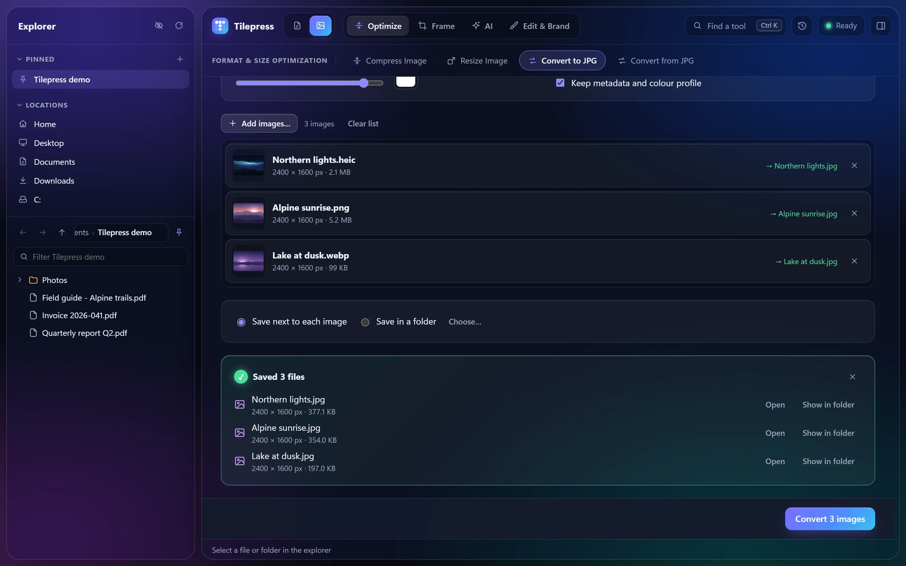

# Format & size

These four tools work on a list of images at once. They read JPG, PNG, WebP, HEIC/HEIF (iPhone), AVIF, GIF, BMP, TIFF and ICO, and save JPG, PNG, WebP, AVIF, GIF, BMP or TIFF. Photos are always handled upright: the camera's rotation flag is applied first. Every tool saves new files and never changes your originals.

In all four tools:

- Add images with **Add images…**, or drag them from the Explorer onto the list. Remove one with the × at the end of its row, or empty the list with **Clear list**.
- Choose **Save next to each image** (the default) or **Save in a folder** and pick the folder with **Choose…**.
- While the tool works, a progress bar shows which file it's on. When it's done, the **Saved** card lists the new files with **Open** and **Show in folder**, and each row shows its result.

See [The Tilepress window](/docs/interface) for the Explorer, the Preview pane and the Saved card.

## Compress Image

Makes images smaller for the web, email or storage. Before you save, it compresses each image in memory with your settings and shows the size the file will really have.

### How to use it

1. In the **Images** section, open the **Optimize** tab and choose **Compress Image**.
2. Click **Add images…**, or drag images from the Explorer onto the list. You can also right-click an image in the Explorer and choose **Compress image**.
3. Pick a preset: **High quality**, **Balanced** or **Smallest**. Or move the **Quality** slider yourself.
4. Change the other options if you need to (see below).
5. Check the rows. Each one shows the new size, for example "→ 412 KB (−63%)". The action bar shows the **Estimated total** for the whole list.
6. Choose where to save, then click **Compress** (or **Compress 5 images**, for a list of five).

### Options

| Option | What it does | Default |
|---|---|---|
| **High quality** / **Balanced** / **Smallest** | Presets that set Quality to 85, 72 or 55. | Balanced |
| **Format** | **Same as the original**, **JPG**, **WebP**, **AVIF** or **PNG**. | Same as the original |
| **Quality** | 10 to 100. Used for JPG, WebP and AVIF. PNG is lossless and ignores it. | 72 |
| **Limit the size** | **Keep the pixel size**, or shrink each image so its longest side is at most 3840, 2560, 1920, 1600, 1280, 1024 or 800 px. Smaller images are not enlarged. | Keep the pixel size |
| **PNG colours** | Shown only when the output is PNG. **All (lossless)**, **256 colours (much smaller)**, **128 colours** or **64 colours (smallest)**. Fewer colours means a much smaller file, with dithering to smooth the steps. | All (lossless) |
| **Keep metadata (camera details, location)** | Keeps the camera details (EXIF), the colour profile and the DPI. When it's off, all three are removed. | Off |

### Good to know

- New files are named after the original with `_compressed` added, for example `holiday_compressed.jpg`. If that name is taken, Tilepress adds a number: `holiday_compressed (2).jpg`.
- **Same as the original** keeps each file's format, except HEIC/HEIF photos, which become JPG, and ICO files, which become PNG. Tilepress doesn't write those two formats.
- If an image can't get any smaller in its own format and at its own pixel size, Tilepress copies the original file instead of writing a bigger one. Its row then says **Kept original**, and the estimate says "(already small)". If you change the format or use **Limit the size**, the new file is always written, even if it ends up bigger.
- The sizes are measured, not guessed: each image is compressed in memory with your settings. This is done for the first 60 images in the list, one after another, and starts again shortly after you change a setting.
- With **Keep metadata** off, the colour profile goes too, not just the camera and location details.
- Animated GIFs and multi-page TIFFs are compressed as a single picture: only the first frame or page is kept.
- JPGs are saved as progressive JPGs. At Quality 90 or higher, colour detail is kept at full resolution.

## Resize Image

Scales images by a percentage, to exact pixels, or so the longest side fits a size. Each row shows the size the image will become before you save.

### How to use it

1. In the **Images** section, open the **Optimize** tab and choose **Resize Image**.
2. Click **Add images…**, or drag images from the Explorer onto the list. You can also right-click an image in the Explorer and choose **Resize image**.
3. Choose how to size them: **Percentage**, **Pixels** or **Longest side**, and set the size.
4. Check the rows. Each one shows the new size, for example "→ 1920 × 1280 px". "(kept)" means the image stays at its size.
5. Choose the **Resampling**, **Format** and **Quality** if you need to.
6. Choose where to save, then click **Resize** (or **Resize 5 images**).

### Options

| Option | What it does | Default |
|---|---|---|
| **Percentage** → **Scale** | A slider from 5% to 400%, in steps of 5%. | 50% |
| **Pixels** → **Width (px)** and **Height (px)** | The size you want. Leave one empty ("auto") and it follows from the image's proportions. | Width 1920, Height auto |
| **Pixels** → **Keep proportions** | When it's off and you set both width and height, the image is stretched to exactly that size. | On |
| **Pixels** → **When both are set** | Shown when **Keep proportions** is on and you set both sizes. **Fit inside (no cropping)** makes the image fit inside the box. **Fill exactly (crop the overflow)** fills the box and trims the overflow equally from both sides. | Fit inside (no cropping) |
| **Longest side** → **Longest side (px)** | The longest side becomes this size; the other follows. From 16 to 20,000 px. | 1920 |
| **Resampling** | **Lanczos (sharpest)**, **Bicubic (smooth)** or **Nearest (pixel art)**, which keeps hard pixel edges. | Lanczos (sharpest) |
| **Format** | **Same as the original**, **JPG**, **PNG**, **WebP** or **AVIF**. | Same as the original |
| **Quality** | 10 to 100, for JPG, WebP and AVIF. Hidden when you choose PNG. | 90 |
| **Never enlarge (images already smaller are kept as they are)** | If the new size would be bigger than the image in either direction, the image keeps its size. | On |

### Good to know

- New files are named after the original with `_resized` added, for example `holiday_resized.jpg`.
- An image that **Never enlarge** leaves at its size is still saved as a new `_resized` file.
- The result can't be larger than 200 megapixels. Above that, Tilepress asks you to choose a smaller size.
- The camera details and the colour profile are kept.
- When an image with transparency is saved as JPG, the transparent areas become white.
- Animated GIFs and multi-page TIFFs are resized as a single picture: only the first frame or page is kept.

## Convert to JPG

Turns PNG, WebP, HEIC (iPhone), AVIF, GIF, BMP, TIFF and ICO images into JPG. Transparent areas get a background colour you choose.

### How to use it

1. In the **Images** section, open the **Optimize** tab and choose **Convert to JPG**.
2. Click **Add images…**, or drag images from the Explorer onto the list. JPG files aren't accepted here, since they already are JPG.
3. Set the **Quality** and the **Background for transparency**.
4. Choose where to save, then click **Convert** (or **Convert 5 images**).

### Options

| Option | What it does | Default |
|---|---|---|
| **Quality** | 10 to 100. | 90 |
| **Background for transparency** | The colour that fills transparent areas, since JPG can't store transparency. | White |
| **Keep metadata and colour profile** | Keeps the camera details (EXIF), the colour profile and the DPI. | On |
| **Every page / frame as its own JPG (multi-page TIFF, animated GIF)** | Shown when the list has a GIF or TIFF. Saves each page or frame as its own JPG. When it's off, only the first page or frame is converted. | Off |

### Good to know

- New files keep the original's name with a `.jpg` extension: `logo.png` becomes `logo.jpg`. If that name is taken, Tilepress adds a number: `logo (2).jpg`.
- With **Every page / frame as its own JPG**, the files are numbered: `scan_1.jpg`, `scan_2.jpg` and so on.
- After converting, each row shows the name of the file it was saved as.

## Convert from JPG

Exports JPG photos as PNG, WebP, AVIF, GIF, BMP or TIFF, or puts them into a PDF: one document for all of them, or one per photo.

### How to use it

1. In the **Images** section, open the **Optimize** tab and choose **Convert from JPG**.
2. Click **Add images…**, or drag JPG photos (`.jpg`, `.jpeg` or `.jfif`) from the Explorer onto the list.
3. Choose the new format: **PNG**, **WebP**, **AVIF**, **GIF**, **BMP**, **TIFF** or **PDF**.
4. Set the options for that format (see below).
5. To save pictures, or one PDF per photo: choose where to save, then click **Convert** (or **Convert 5 images**).
6. To make one PDF from all the photos: click **Create PDF…** and choose a name and folder in the Save dialog.

### Options

| Option | What it does | Default |
|---|---|---|
| Format | **PNG**, **WebP**, **AVIF**, **GIF**, **BMP**, **TIFF** or **PDF**. | PNG |
| **Quality** | 10 to 100. Shown for WebP and AVIF only; the other picture formats are lossless. | 90 |
| **PDF** | For PDF: **All photos in one PDF (list order)** or **One PDF per photo**. | All photos in one PDF (list order) |
| **Page size** | For PDF: **Same as the photo**, **A4** or **Letter**. | Same as the photo |

### Good to know

- Pictures keep the original's name with the new extension: `photo.jpg` becomes `photo.png`, `photo.webp` and so on. TIFF files get the `.tif` extension.
- PNG is lossless: the file is usually bigger than the JPG, but nothing more is lost.
- GIF can only hold 256 colours, so photos saved as GIF are reduced to 256 colours, with dithering. TIFF files are saved with lossless compression.
- The camera details and the colour profile are kept where the new format can store them.
- In a PDF, each photo's JPG data is placed into the PDF exactly as it is, so there's no loss of quality. The camera's rotation flag is applied, so photos appear upright.
- **Same as the photo** makes each page exactly the size of its photo, with no margin. **A4** and **Letter** leave a 10 mm margin, turn the page to landscape for landscape photos, and fit the photo inside, centred.
- **All photos in one PDF** uses the order in which you added the photos. The Save dialog suggests the first photo's name with `.pdf`, in the same folder.
- **One PDF per photo** names each PDF after its photo, for example `photo.pdf`.
- For more control over PDFs made from pictures (other image formats, rotating each picture, orientation, margins), use **JPG to PDF** in [Convert to PDF](/docs/to-pdf).
