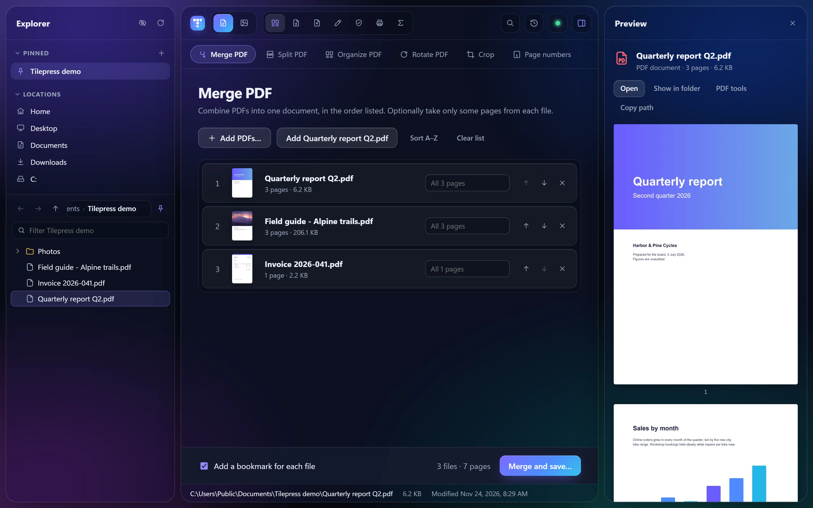
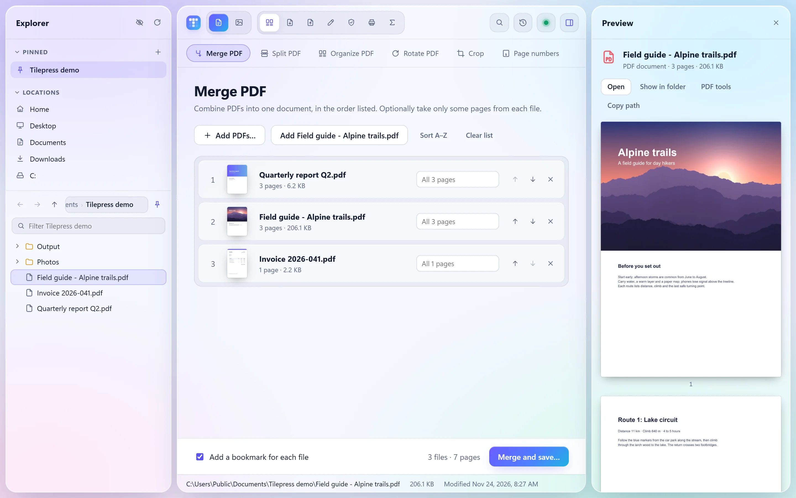

# The Tessera window

The window has three panels side by side:

- the **Explorer** on the left, for finding files and folders;
- the **tools** in the middle, with the top bar above them and a status bar below;
- the **Preview** on the right, showing whatever is selected in the Explorer.

## The top bar

From left to right, the top bar holds:

| Part | What it does |
|---|---|
| **Documents** / **Images** | Switches between the two sections. Documents has the PDF tools and LaTeX; Images has the image tools. |
| Category tabs | The categories of the current section. Hover over a tab for its full name. |
| **Find a tool** | Opens a search box for every tool. Also <kbd>Ctrl</kbd>+<kbd>K</kbd>. See [Find a tool](#find-a-tool). |
| **History** (clock icon) | Lists the files your tools have made. See [History](/docs/history). |
| Status button (dot and **Ready**) | Opens the About box with the version and engines. See [The status button](#the-status-button-and-about-box). |
| Panel button | **Hide preview** / **Show preview**. |

The category tabs are:

| Section | Tab | Full name | Docs |
|---|---|---|---|
| Documents | **Pages** | Combine, Split & Page Management | [Combine, split & pages](/docs/pdf-pages) |
| Documents | **To PDF** | Conversion: To PDF | [Convert to PDF](/docs/to-pdf) |
| Documents | **From PDF** | Conversion: From PDF | [Convert from PDF](/docs/from-pdf) |
| Documents | **Edit & Forms** | Editing, Forms & Text Recognition | [Edit, forms & OCR](/docs/edit) |
| Documents | **Security** | Security, Signatures & Optimization | [Security, signing & size](/docs/security) |
| Documents | **Print** | Printing & Output | [Printing](/docs/print) |
| Documents | **LaTeX** | LaTeX | [LaTeX](/docs/latex) |
| Images | **Optimize** | Format & Size Optimization | [Format & size](/docs/img-optimize) |
| Images | **Frame** | Framing, Layout & Generation | [Crop, rotate & capture](/docs/img-layout) |
| Images | **AI** | AI & Smart Enhancements | [AI enhancements](/docs/img-ai) |
| Images | **Edit & Brand** | Editing & Branding | [Edit & brand](/docs/img-edit) |

When the middle panel is narrow, the top bar saves space: the labels disappear and only the icons stay. Hover over an icon to see what it is.

## The tool strip

Under the top bar, the tool strip shows the full name of the category and a button for each of its tools. Hover over a tool for a one-line description. Print and LaTeX have only one tool each, so they have no tool strip.

Tessera remembers where you were: each section reopens its last category, and each category its last tool.

Switching tools doesn't lose your work. Every tool keeps its files and settings while you use other tools, until you close Tessera.

## The Explorer

The Explorer has three parts: **Pinned**, **Locations** and the folder tree. Click **Pinned** or **Locations** to fold that part away.

Two buttons sit in the Explorer header:

- **Show hidden items** (the eye) shows files and folders that are hidden. Tessera counts as hidden anything Windows marks as hidden or system, and names that start with a dot. Hidden items appear dimmed.
- **Refresh** reads the open folders again. You rarely need it: when a tool saves a file, the Explorer refreshes by itself.

### Pinned

Your saved folders. To pin a folder:

- right-click it and choose **Pin**;
- open it and click the pin button at the end of the path bar (**Pin this folder**);
- click **+** (**Pin a folder…**) next to the Pinned heading and choose a folder;
- or drag a folder from the tree onto the Pinned list, at the place you want it.

Drag pins to reorder them, or right-click a pin and choose **Move up** or **Move down**. The right-click menu also has **Open**, **Unpin**, **Open in File Explorer** and **Copy path**. A pin whose folder no longer exists is struck through, and its tooltip says "Folder not found".

### Locations

**Home**, **Desktop**, **Documents** and **Downloads**, followed by every drive. Desktop, Documents and Downloads point to the real folders even when OneDrive or your organisation has moved them. Click a location to show it in the tree.

### The folder tree

The tree shows the current folder. Folders come first, then files, sorted so that "file2" comes before "file10". Hover over an item to see its full path, size and last change.

- **Click** a folder to expand or collapse it. Its contents are read when you expand it.
- **Double-click** a folder to make it the current folder, or a file to open it in its usual app.
- **Right-click** an item for its menu (see below).
- **Drag** a folder onto Pinned, or a file onto a tool.

A folder with more than 5,000 items shows the first 5,000 and says so.

### The path bar

Above the tree:

- **Back**, **Forward** and **Up one level** buttons.
- Breadcrumbs: click any folder in the path to go there.
- Click the path bar, or press <kbd>Ctrl</kbd>+<kbd>L</kbd>, to type a path. Press <kbd>Enter</kbd> to go there or <kbd>Esc</kbd> to cancel. You can use `~` for your home folder and Windows variables such as `%USERPROFILE%`. A drive letter on its own, such as `D:`, works too.
- The pin button at the end pins or unpins the current folder.

### Filter

The **Filter** box under the path bar narrows the tree to names that contain what you type. It only searches the folders that are already open in the tree, not their unopened subfolders. A folder stays visible if something inside it matches. Press <kbd>Esc</kbd> or click × to clear the filter, and <kbd>↓</kbd> to move into the tree.

### Right-click menus

| You right-click | Menu |
|---|---|
| A file | **Open**, **Show in File Explorer**, the tools that fit the file, **Copy path** |
| A folder or a location | **Open**, **Pin** or **Unpin**, **Open in File Explorer**, **Copy path** |
| A pin | **Open**, **Unpin**, **Move up**, **Move down**, **Open in File Explorer**, **Copy path** |
| An empty part of the tree | **Pin this folder** or **Unpin this folder**, **Refresh**, **Show hidden items** or **Hide hidden items**, **Open in File Explorer**, **Copy path** |

The tool entries for each file type are listed in [Getting started](/docs/). Use <kbd>↑</kbd> and <kbd>↓</kbd> to move through a menu and <kbd>Esc</kbd> to close it.

## The Preview pane

The Preview shows the item selected in the Explorer, and follows along as you move through the tree with the arrow keys.

| Selection | What you see |
|---|---|
| PDF | Every page, loaded as you scroll, with page numbers. The details add the title and the size of the first page in mm. |
| Image (PNG, JPEG, GIF, WebP, BMP, TIFF, ICO, SVG) | The picture, the right way up for photos taken with the camera turned. Click it to switch between fitted and actual size. The details add the colour mode, and the number of frames for an animation (the first frame is shown). |
| Text and code | The first 256 KB with line numbers, the number of lines, the encoding and the line endings. Tick **Wrap** to wrap long lines. Files with an unknown extension are shown this way if they look like text. |
| CSV and TSV | A table of the first 300 rows and up to 40 columns. For CSV files, commas, semicolons, tabs and `|` are detected as separators. |
| Folder | How many folders and files are directly inside (not in subfolders), their total size, the most common file types, and the item that changed last. Very large folders are counted up to 20,000 items. |
| Anything else | The details only. |

Under the name, buttons act on the item:

- **Open** opens a file in its usual app. For a folder, the button is **Open in File Explorer**.
- **Show in folder** opens File Explorer with the file selected.
- **PDF tools** (PDFs), **Edit photo** (images) and **Convert to PDF** (files a Convert to PDF tool accepts) open the file in that tool.
- **Copy path** copies the full path.

At the bottom, the details list the type, size, modified and created dates, and the folder the item is in.

Close the Preview with its × button (**Hide preview**). Bring it back with the panel button at the right end of the top bar.

## Working in a tool

### Opening a file

Until you give it a file, a tool shows a drop area with a button such as **Open PDF…** or **Open image…**, and a **Use** button for the file selected in the Explorer if it fits. [Getting started](/docs/) lists all the ways to open a file.

Once a file is open, a bar at the top shows its name, page count or pixel size, and file size. It has:

- **Use** *name*, when a different suitable file is selected in the Explorer;
- **Change…** to pick another file;
- **Close** to put the file away.

You can also drop another file from the Explorer onto that bar.

Tools that work on many files at once show a list instead, with buttons such as **Add images…** and **Clear list**, and × on each row to remove it.

### The action bar

The action bar runs along the bottom of each tool. It stays in view while you scroll, and sits at the bottom of the window when the tool is shorter than the window.

- On the left, it sums up what will happen, for example how many pages or files, or holds a related option.
- On the right is the **main button** that runs the tool, for example **Merge and save…** or **Compress 5 images**. It stays greyed out until the tool has what it needs.

A button whose label ends in "…" asks first where to save. Most open a Save dialog with a suggested name, made from the original name plus a word such as `_rotated`, in the original's folder. If that name is taken, the suggestion becomes `name (2)` and so on, so nothing is overwritten unless you choose to. Tools that write many files ask for a folder, or offer **Save next to each file** and **Save in a folder** with a **Choose…** button.

While a tool works, its button shows **Working…** and a progress bar appears. Long jobs show a percentage and what they're doing. If something goes wrong, the message appears in a red box above the action bar. Your original files are never changed.

### The Saved card

When a tool has saved, a **Saved** card appears (**Saved 3 files** for several). For each new file it shows the name, the page count or pixel size, and the file size. Hover over a name to see its full path.

| Button | What it does |
|---|---|
| **Open** | Opens the file in its usual app. |
| **Show in folder** | Opens File Explorer with the file selected. |
| **Keep editing this file** | Opens the new file in Tessera, so you can take the next step on it. It appears when the result is a single PDF or image, in the tools that support it. |

Click × to dismiss the card. When a tool makes many files, the card lists the first 12 and says how many more there are. Every run is also recorded in the [History](/docs/history).

## Find a tool

Click **Find a tool** in the top bar or press <kbd>Ctrl</kbd>+<kbd>K</kbd>. Type any part of a tool's name, what it does, or its category, for example *merge*, *sign*, *word* or *ocr*. With several words, a tool must match all of them. Tools whose name starts with what you typed come first.

- <kbd>↑</kbd> and <kbd>↓</kbd> move through the list; <kbd>Enter</kbd> opens the highlighted tool.
- <kbd>Esc</kbd>, <kbd>Ctrl</kbd>+<kbd>K</kbd> again, or a click outside closes the box.

Each result shows its category tab, or **Open** for the tool you're in.

## The status button and About box

The status button in the top bar shows a dot and **Ready** once the window is connected to Tessera's engine. Click it for the About box:

| Row | Shows |
|---|---|
| Header | The version, and how fast the window talks to the engine. |
| **LaTeX** | The LaTeX engine in use, or the state of its first-run setup. |
| **OCR** | Tesseract (and how many languages it has) and the Windows OCR languages, or "Not available". |
| **Office conversion** | The Microsoft Office apps found, or LibreOffice, or "Not found". |
| **Python**, **System**, **Mode** | Version details, useful when you [ask for help](/support). |

If the LaTeX setup failed, the About box has a **Retry LaTeX setup** button. Press <kbd>Esc</kbd> or click elsewhere to close it.

## The status bar

The bar at the bottom of the middle panel shows the path, size and last change of the item selected in the Explorer. During the first-run LaTeX setup, it also shows the progress, such as **Downloading LaTeX engine… 40%**.

## Resizing the panels

Drag the gap between two panels to resize them. You can also click the gap (or move to it with <kbd>Tab</kbd>) and use <kbd>←</kbd> and <kbd>→</kbd>. Double-click the gap to go back to the default width. The tools in the middle always keep at least 460 pixels.

## Light and dark theme

Tessera follows the Windows app mode. It's light when apps are set to Light under **Settings** > **Personalization** > **Colors**, and dark otherwise. If you turn off **Animation effects** in the Windows accessibility settings, Tessera turns off its animations too.

## Keyboard shortcuts

Shortcuts that work across the window:

| Keys | Action |
|---|---|
| <kbd>Ctrl</kbd>+<kbd>K</kbd> | Open or close Find a tool |
| <kbd>Ctrl</kbd>+<kbd>L</kbd> | Type a folder path in the Explorer |
| <kbd>Alt</kbd>+<kbd>←</kbd> / <kbd>Alt</kbd>+<kbd>→</kbd> | Back / forward in the Explorer (while it has the focus) |
| <kbd>Esc</kbd> | Close Find a tool, a menu, or the History or About box; clear the Explorer filter |

In the folder tree:

| Keys | Action |
|---|---|
| <kbd>↑</kbd> / <kbd>↓</kbd>, <kbd>Home</kbd> / <kbd>End</kbd> | Move the selection |
| <kbd>→</kbd> | Expand a folder, or move into it if it's already expanded |
| <kbd>←</kbd> | Collapse a folder, or move to its parent |
| <kbd>Enter</kbd> | Open a file, or make a folder the current folder |
| <kbd>Backspace</kbd> | Go up one level |
| Letters | Jump to the next item whose name starts with what you type |
| <kbd>Menu</kbd> key | Open the right-click menu of the selected item |

Some tools have shortcuts of their own, described on their pages: [Organize PDF](/docs/pdf-pages), [Edit PDF](/docs/edit), [Sign PDF](/docs/security), the [LaTeX editor](/docs/latex), the [Photo editor](/docs/img-edit) and [Blur face](/docs/img-ai).

## What Tessera remembers

Between sessions, Tessera keeps your pins, the last folder you were in, whether hidden items are shown, the widths of the Explorer and Preview, whether the Preview is open, and whether history is on. They're saved in `%LOCALAPPDATA%\Tessera\settings.json`. See [Privacy](/docs/privacy) for everything else in that folder.
