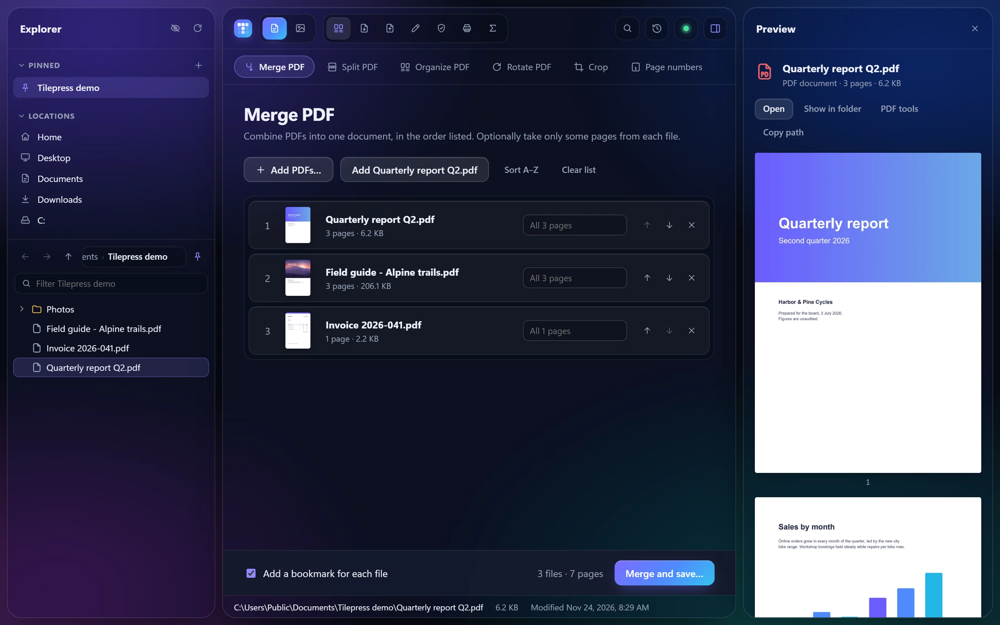
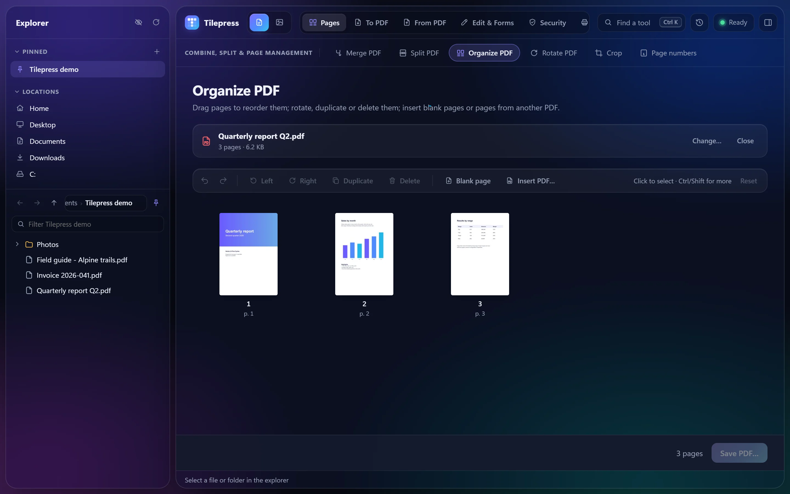

# Combine, split & pages

These tools change which pages a PDF has, their order and their shape: merge several files, split one apart, reorder and rotate pages, crop margins and stamp page numbers. In the app this category is the **Pages** tab under **Documents**.

Merge PDF keeps its own list of files. The other five tools work on one open PDF, and they share it: open a file in Split PDF, switch to Rotate PDF, and the same file is already there. To open a PDF, drag it from the Explorer onto the tool, click **Open PDF…**, or click **Use** followed by the name of the PDF selected in the Explorer. You can also right-click a PDF in the Explorer and choose **Open in PDF tools**, which opens it in the page tool you used last (or in Organize PDF if that was Merge PDF). See [The Tilepress window](/docs/interface) for the Explorer and the other general controls.

Every tool saves a **new** file and leaves the original alone. When it's done, a **Saved** card lists the result with **Open** and **Show in folder** buttons. When the result is a single PDF, **Keep editing this file** opens it straight away for the next step. Each run is also listed in the [History](/docs/history).

::: details How to type page ranges
Several tools take a list of pages. They all read it the same way:

- Single pages and ranges, separated by commas or semicolons: `1-3, 5, 8-10`.
- Open-ended ranges: `8-` means page 8 to the end, `-4` means pages 1 to 4.
- The words `all`, `odd` and `even`.

A range that goes past the last page, or runs backwards (`5-2`), is reported as an error and nothing is saved.
:::

## Merge PDF

Merge PDF combines several PDFs into one document, in the order of the list. You can take only some pages from each file.

### How to use it

1. Open **Merge PDF**.
2. Click **Add PDFs…** and choose one or more files. You can also drag PDFs from the Explorer into the list, or click **Add** followed by the name of the PDF selected in the Explorer.
3. Put the files in order. Drag a row up or down, or use its **Move up** and **Move down** buttons. **Sort A–Z** sorts the list by file name.
4. To take only some pages from a file, type them in that file's page box (it shows "All *N* pages" while empty). The number of pages it selects appears underneath.
5. Click **Merge and save…**, choose a name and folder, and click **Save**.

### Options

| Option | What it does | Default |
|---|---|---|
| Page box (per file) | The pages to take from that file, for example `2-5, 9`. Empty takes every page. | Empty (all pages) |
| **Add a bookmark for each file** | Adds a bookmark named after each file (without `.pdf`) that jumps to its first page in the merged document. | On |

The bar at the bottom shows how many files and pages the result will have. **Remove** (the × on a row) takes a file off the list, and **Clear list** empties it.

### Good to know

- Only PDF files can be added. You can add the same file more than once, for example with different page ranges.
- Pages are taken in the order you type them, so `5, 1-4` puts page 5 first. A page listed twice appears twice.
- The Save dialog suggests the first file's name with `_merged` added, for example `report_merged.pdf`, in the same folder. If that name is taken, it suggests `report_merged (2).pdf`.
- **Merge and save…** stays greyed out while a page box has an error.
- **Keep editing this file** opens the merged PDF in Organize PDF.
- A PDF that needs a password to open can't be added. Remove the password first with [Protect PDF](/docs/security).

## Split PDF

Split PDF divides a PDF into separate files, or copies chosen pages into a new file.

### How to use it

1. Open **Split PDF** and open a PDF.
2. Pick a mode: **By ranges**, **Every N pages** or **Extract pages**.
3. Fill in the field for that mode (see below). The page grid shows the result: each page gets a coloured number badge for the file it goes into, and pages that aren't used are dimmed.
4. Check the line next to the button, for example "Creates 3 files".
5. Click **Split and save to folder…** and choose a folder.

### Options

| Mode | What you enter | Result |
|---|---|---|
| **By ranges** | Page ranges, for example `1-3, 4-8, 9-`. | One file per range. When you open a file, this is filled in with its first and second half. |
| **Every N pages** | **Pages per file** (default 1). | The document cut into files of that many pages. The last file may be shorter. |
| **Extract pages** | The pages to copy. Click pages in the grid to add or remove them, or type them, for example `1-3, 7`. | One file with those pages. Tick **One file per page** to get a separate file for each page instead (off by default). |

### Good to know

- The folder dialog starts in the PDF's own folder.
- Files are named after the original with the pages they hold: `report_p3.pdf` for one page, `report_p1-4.pdf` for a run of pages, and `report_part2.pdf` (the file's number) for anything else. An existing file is never replaced: the new one gets ` (2)`, ` (3)` and so on.
- In **By ranges**, ranges may overlap. A page that is in two ranges goes into both files.
- In **Extract pages**, pages are written in page order, whatever order you type them in.
- The **Saved** card lists up to 12 files and says how many more there are. **Keep editing this file** appears only when the split made a single file.

## Organize PDF

Organize PDF lets you rearrange a document page by page: reorder, rotate, duplicate and delete pages, and insert blank pages or pages from another PDF.

### How to use it

1. Open **Organize PDF** and open a PDF. Every page appears as a thumbnail.
2. Click a page to select it. <kbd>Ctrl</kbd>-click adds or removes pages from the selection, and <kbd>Shift</kbd>-click selects a run of pages. Clicking an empty part of the grid clears the selection.
3. Change the pages:
   - Drag a page to a new place. If it's part of the selection, all selected pages move together.
   - Use the toolbar buttons **Left**, **Right** (rotate by 90°), **Duplicate** and **Delete** on the selected pages.
   - Or hover over a page and use its own **Rotate left**, **Rotate right**, **Duplicate** and **Delete** buttons. These act on the whole selection if that page is selected, otherwise on that page alone.
   - Click **Blank page** to insert an empty page.
   - Click **Insert PDF…** to insert all pages of another PDF, or drag a PDF from the Explorer onto the grid where you want its pages.
4. Use the undo and redo buttons if you change your mind, or **Reset** to go back to the original pages.
5. Click **Save PDF…**, choose a name and folder, and click **Save**.

### Options

| Control | What it does |
|---|---|
| **Left** / **Right** | Rotate the selected pages 90° anticlockwise or clockwise. |
| **Duplicate** | Places a copy right after each selected page. |
| **Delete** | Removes the selected pages. |
| **Blank page** | Inserts an empty page after the last selected page, or at the end if nothing is selected. It has the same size as the page before it (A4 if there is none). |
| **Insert PDF…** | Inserts every page of another PDF after the last selected page, or at the end. The inserted pages are selected afterwards. |
| Undo / Redo | Steps back and forward through your changes (up to 100 steps). |
| **Reset** | Throws away all changes and shows the original pages again. |

Each thumbnail shows its new position and where it came from: `p. 3` for page 3 of the open file, the file name and page for an inserted PDF, or `Blank`.

### Keyboard shortcuts

Click the page grid first so it has the keyboard focus.

| Keys | Action |
|---|---|
| <kbd>Delete</kbd> or <kbd>Backspace</kbd> | Delete the selected pages |
| <kbd>Ctrl</kbd>+<kbd>A</kbd> | Select all pages |
| <kbd>Ctrl</kbd>+<kbd>Z</kbd> | Undo |
| <kbd>Ctrl</kbd>+<kbd>Y</kbd> or <kbd>Ctrl</kbd>+<kbd>Shift</kbd>+<kbd>Z</kbd> | Redo |
| <kbd>Esc</kbd> | Clear the selection |

### Good to know

- **Save PDF…** stays greyed out until you've changed something.
- The Save dialog suggests the original name with `_organized` added, for example `report_organized.pdf`.
- Pages are copied as they are, not re-rendered, so text stays selectable and quality is unchanged. Rotation is added to any rotation the page already had.
- If you delete every page, the grid says so; undo, insert pages, or drop a PDF onto it before you can save.

## Rotate PDF

Rotate PDF turns pages by 90°, 180° or 270°. You can rotate single pages, a selection, odd or even pages, or the whole document. The thumbnails show the result straight away.

### How to use it

1. Open **Rotate PDF** and open a PDF.
2. Choose which pages to turn: click pages to select them, or use **All**, **Odd** or **Even** next to **Select**. **None** clears the selection.
3. Click **90° left**, **90° right** or **180°**. With no pages selected, these turn every page. You can click them more than once.
4. To turn a single page, hover over it and use its **Rotate left** or **Rotate right** button.
5. Click **Save rotated PDF…**, choose a name and folder, and click **Save**.

### Options

| Control | What it does |
|---|---|
| **All**, **Odd**, **Even**, **None** | Select every page, pages 1, 3, 5…, pages 2, 4, 6…, or nothing. |
| **90° left**, **90° right**, **180°** | Rotate the selected pages, or all pages if none are selected. The text in brackets says which. |
| **Reset** | Removes all the rotations you've added. |

Each rotated page shows how far it has been turned, for example `+90°`.

### Good to know

- **Save rotated PDF…** stays greyed out until at least one page is rotated. The bar shows how many pages are rotated.
- The Save dialog suggests the original name with `_rotated` added.
- Rotation only changes how the page is displayed. Nothing is re-rendered, so there is no loss of quality.

## Crop PDF

Crop PDF trims the margins of pages. On screen the tool is called **Crop**. You can drag a box on the page, type the margins in millimetres, or let the tool find the content for you.

### How to use it

1. Open **Crop** and open a PDF. The current page is shown with the crop box on top. Use the arrows or the page number under it to move between pages.
2. Set the box in any of these ways:
   - Drag the box to move it, or drag its corners and edges to resize it.
   - Press outside the box and drag to draw a new one.
   - Type the margins under **Margins (mm)**: **Top**, **Right**, **Bottom** and **Left**.
   - Click **Auto-detect content** to fit the box around what's printed on the current page.
3. Check the line under the margins, for example "Page 1 becomes 180 × 250 mm".
4. Under **Apply to**, choose **All pages**, **Only page** *N* (the page on screen), or **Pages** and type a list such as `2-5, 8`.
5. Click **Save cropped PDF…**, choose a name and folder, and click **Save**.

### Options

| Option | What it does | Default |
|---|---|---|
| **Top**, **Right**, **Bottom**, **Left** | How much to trim from each side, in millimetres (steps of 0.5 mm). | 0 |
| **Auto-detect content** | Looks at the current page for anything that isn't white and sets the margins to just outside it, leaving about 2 mm. | |
| **Reset** | Sets all margins back to 0. | |
| **Apply to** | **All pages**, **Only page** *N*, or **Pages** with a list. | All pages |

### Good to know

- The same margins are trimmed from every chosen page, measured from each page's own edges. Auto-detect uses the page on screen only, so check other pages if their layout differs.
- Margins are measured on the page as you see it, so rotated pages are cropped correctly.
- What's left must be at least 18 points (about 6.4 mm) wide and high. If the margins leave less, the size line turns red and saving fails with "The margins leave nothing of page *N*".
- The Save dialog suggests the original name with `_cropped` added.

::: warning Cropping hides, it doesn't delete
Content outside the box is hidden, not removed. It's still in the file and can come back if someone changes the page box. To really remove something, use **Redact** in [Edit PDF](/docs/edit).
:::

## Page numbers

Page numbers stamps a number on each page. You choose the position, the format, which pages are numbered and the number to start from. The preview shows the number on the page as you change the settings.

### How to use it

1. Open **Page numbers** and open a PDF.
2. Under **Position**, click one of the six spots: top or bottom, left, centre or right.
3. Under **Format**, pick a format, or **Custom…** and type your own.
4. Under **Pages**, set **Number pages** from and to, and the **First number**.
5. Under **Style**, set the **Size (pt)**, **Margin (mm)** and **Colour**.
6. Use the arrows under the preview to check other pages. Pages that won't get a number say "Not numbered".
7. Click **Add numbers and save…**, choose a name and folder, and click **Save**.

### Options

| Option | What it does | Default |
|---|---|---|
| **Position** | Where the number goes: top or bottom, and left, centre or right. | Bottom centre |
| **Mirror on even pages (double-sided)** | On even pages, left and right swap, so numbers sit on the outer edge when printed on both sides. Has no effect on centred numbers. | Off |
| **Format** | `1`, `Page 1`, `Page 1 of 9`, `1 / 9`, `- 1 -`, or **Custom…**. | `1` |
| Custom format | Your own text. `{n}` is the number and `{total}` is the last number used, for example `Report – {n}/{total}`. It must contain `{n}`. | `Page {n}` |
| **Number pages** … **to** … | The first and last page to number. Pages outside this range are left alone. | The whole document |
| **First number** | The number printed on the first numbered page. | 1 |
| **Size (pt)** | Text size, from 4 to 96 points. | 11 |
| **Margin (mm)** | Distance from the edges of the page. | 12 |
| **Colour** | **Black**, **Dark grey**, **Grey**, **White**, or **Custom** with a colour picker. | Black |

### Good to know

- `{total}` is the last number printed, not the page count. If you number pages 3 to 10 starting at 1, `{total}` is 8.
- **Mirror on even pages** goes by the page's position in the file, not by the number printed on it.
- Numbers are written in the standard Helvetica font, so use Latin characters. Characters that font can't show are printed as `?`.
- On pages that are rotated, the number goes at the top or bottom as you see the page.
- **Add numbers and save…** stays greyed out while the format has no `{n}`, the page range is wrong, or the size is outside 4–96 pt. The reason is shown in red above the button.
- The Save dialog suggests the original name with `_numbered` added.
